# Heavy Rainfall: Applications from the FSTP regions

The HR workflow provides a step-by-step framework for assessing changes in extreme rainfall across regions, offering a common starting point for identifying changes in rainfall intensity, return periods and threshold exceedance. As a next step, it is necessary to further anchor the results of the HRW in the local capacities and needs of regions as to identify the local adaptation measures needed to reduce risk.

The regional projects presented below addressed this challenge by adapting and extending the HRW to their local scale. Through their climate risk assessments, they have connected the HRW to local observations, impact records, warning thresholds, hydraulic and drainage processes, exposed receptors or damage estimates. For more detailed information on each of the regions, consult the reference section for the complete public deliverables.

## 1. Locally informed rainfall-impact thresholds

Historical rainfall observations and documented impacts can help regions identify locally relevant critical rainfall thresholds for the HRW. By examining the rainfall conditions associated with past flooding, damage or disruption, regions can identify thresholds that reflect their local risk context.

The following examples illustrate different ways of connecting historical rainfall evidence and observed impacts with climate risk assessment, from local threshold definition to the evaluation of existing hazard maps.

### Region Examples

#### Quart de Poblet (Spain)

Quart de Poblet illustrates two complementary ways of incorporating local evidence into the assessment. First, the municipality combined local rainfall observations, historical events and official warning thresholds to establish a critical rainfall threshold reflecting local conditions. This threshold was subsequently used in the HRW to assess projected changes in extreme rainfall.

In parallel, the impacts of the October 2024 DANA, which caused severe flooding across the Valencia region, were compared with existing flood-hazard maps. This allowed the municipality to assess whether the mapped hazard was consistent with the observed flooding and to identify areas where flood extent or impacts may have been underestimated.

| Parameter | Value |
|---|---|
| Historical period | 1976–2005 |
| Intensity | 98 mm/24h |
| Duration | 24 hours |
| Frequency | 5 years |
| Location | Quart de Poblet |

  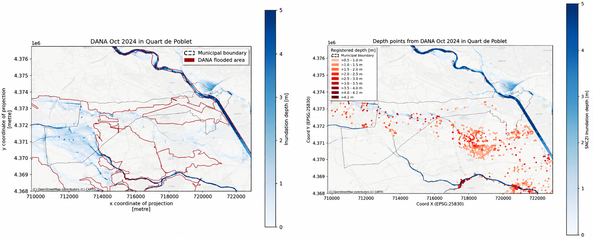
    <figcaption>Figure 1. Comparison of the flood footprint (left) and depths (right) reached due to the DANA 2024 compared to what is expected for a return period of 500 years. (Source: Quart de Poblet; QCATI; Deliverable 2)</figcaption>

#### County Louth (Ireland)

County Louth adopted a multi-threshold approach to represent different levels of rainfall-related impacts. Using official rainfall observations, historical event records and stakeholder information, the region established three rainfall thresholds for low, medium and high impact levels. Their relevance was assessed against documented impacts and past rainfall events.

The thresholds were then incorporated into the HRW to explore how rainfall conditions associated with these different impact levels may change under future climate scenarios.
| Threshold | Intensity (mm/24h) | Baseline RP (yr) | Climate signal Δ% | Future RP (yr) |
|---|---:|---:|---:|---:|
| Low | 38.5 | 2 | +23.8 | 2 |
| Medium | 56.0 | 10 | +15.7 | 6 |
| High | 63.3 | 20 | +12.5 | 13 |

  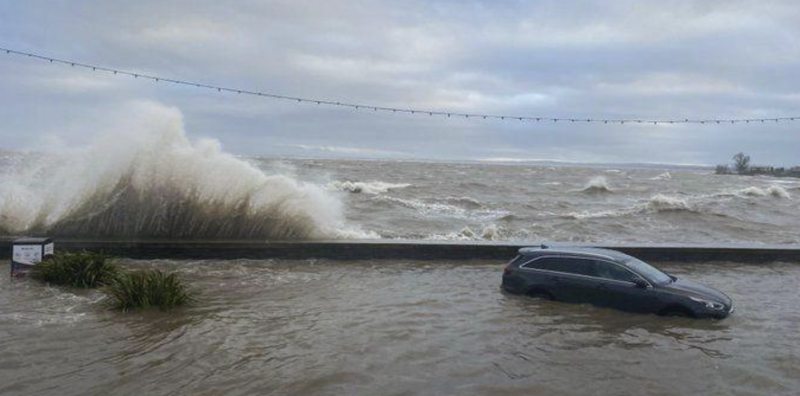
    <figcaption>Figure 2. Blackrock February 2026 (Source: County Louth; LCRAA; Deliverable 2).</figcaption>

#### Mersin (Türkiye)

Mersin used historical precipitation observations and documented flood events to identify rainfall thresholds associated with different levels of potential impact. The study established four rainfall thresholds, each corresponding to a different impact category and baseline return period.

| Impact level | Rainfall threshold | Baseline return period |
|---|---:|---:|
| Moderate | 80 mm/24 h | 5 years |
| High | 100 mm/24 h | 10 years |
| Very High | 130 mm/24 h | 25 years |
| Catastrophic | 180 mm/24 h | 50 years |

These thresholds were incorporated into the HRW to assess how the magnitude and frequency of rainfall conditions associated with different impact levels could evolve under future climate scenarios. Similar to County Louth, the application illustrates how impact-based severity categories can be connected to projected changes in extreme rainfall, supporting a more locally relevant interpretation of future climate conditions.

## 2. Climate risk assessment using operational warning thresholds

Connecting rainfall thresholds to operational early warning requires aligning critical rainfall conditions with the timing, context and criteria of warning decisions. While the HRW assesses how critical rainfall conditions may change under future climate scenarios, operational warning systems also consider the timing, duration and spatial distribution of rainfall, together with local conditions that influence the hazard response.

Depending on the local warning context, rainfall thresholds may be adapted to account for antecedent catchment conditions, different rainfall accumulation periods, or spatial variations in hazard and warning criteria. These approaches help connect rainfall information with the requirements of local warning systems and decision-making processes.

### Region Examples

#### Valchiavenna (Italy)

Valchiavenna applied the Equivalent Rainfall (Peq) method to incorporate antecedent catchment wetness into the assessment of operational rainfall thresholds. Based on a reformulation of the SCS-CN (Curve Number) model, the method uses rainfall accumulated over the previous five days to express forecast precipitation as an equivalent amount under dry-soil conditions.

This allows rainfall to be evaluated against established warning thresholds while accounting for changing catchment conditions. The same rainfall amount can therefore lead to different warning levels depending on preceding wetness. Valchiavenna integrated this approach into its climate assessment to investigate changes in the frequency of operationally relevant warning threshold exceedances under future climate scenarios.

  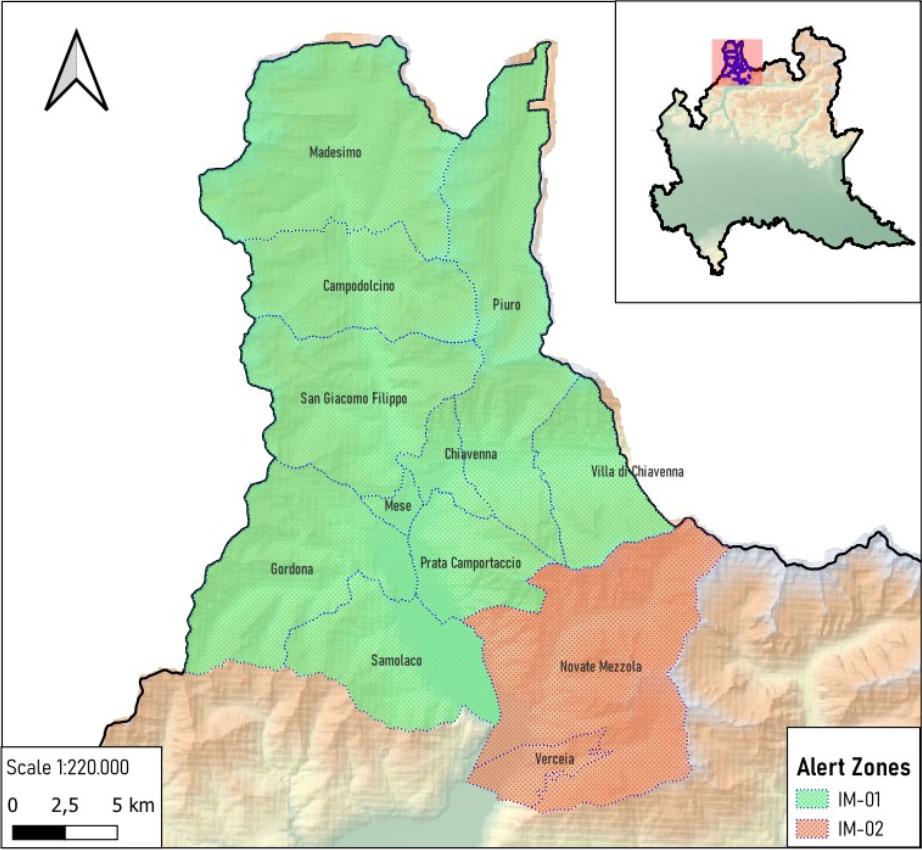
    <figcaption>Figure 3. Homogenous alert zones of Valchiavenna from the regional Civil Protection system of Lombardy Region.(Source: Valchiavenna; CMV4Clima; Deliverable 2)</figcaption>

## 3. Translation of rainfall into hydrological, hydraulic or drainage outputs

Projected changes in extreme rainfall can be combined with local infrastructure and terrain information to assess how urban areas may respond to future rainfall conditions. This pathway extends the assessment by connecting projected rainfall conditions with local drainage characteristics and design capacities, allowing regions to evaluate the adequacy of existing infrastructure under future climate conditions.

Regional applications illustrate two complementary approaches: estimating the additional drainage capacity required under future rainfall conditions and mapping potential surface-water accumulation and inundation.

### Region Examples

#### Viana do Castelo (Portugal)

Viana do Castelo connected projected changes in extreme rainfall with existing drainage infrastructure and design capacity. The municipality combined EURO-CORDEX projections with local intensity–duration–frequency (IDF) curves and drainage design information to evaluate future infrastructure requirements.

The assessment also analysed 1,321 georeferenced historical incidents using DBSCAN spatial clustering to identify recurring drainage hotspots. Building on this local evidence, the municipality introduced a drainage gap metric to estimate the additional drainage capacity needed to maintain existing protection levels under future rainfall conditions. For example, at Hotspot 13, Rua da Ameixoeira, a projected increase of approximately 2% in extreme rainfall intensity was associated with a 9% increase in required drainage capacity. This translates a relatively small climate signal into a quantifiable infrastructure requirement that can support the prioritisation and planning of drainage upgrades.

  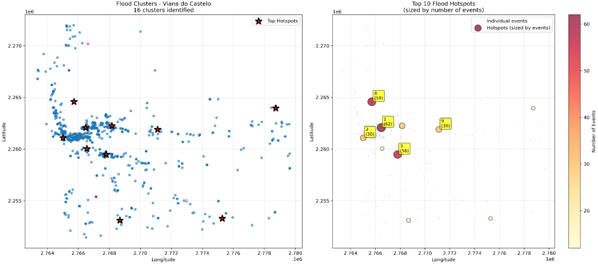
    <figcaption>Figure 4. Identification of the 10 critical rainfall hotspots through DBSCAN clustering of historical events in Viana do Castelo Municipality.(Source: Viana do Castelo; VC_Climax; Deliverable 2)</figcaption>

#### Länsstyrelsen Västernorrland (Sweden)

In Sundsvall, the assessment used officially adopted flood hazard maps to analyse the consequences of both river flooding from Selångersån and heavy rainfall. The maps show the extent and depth of flooding, including inundation during a 100-year rainfall event. By combining this information with data on population, infrastructure, land use and critical services, the assessment identified the areas and assets most exposed to flooding.

This approach connects extreme rainfall with its potential physical impacts and provides locally detailed information to support spatial planning, emergency preparedness and the prioritisation of mitigation measures. It also illustrates how existing flood hazard and risk maps can be integrated into a regional climate risk assessment to improve the understanding of rainfall-related impacts.

  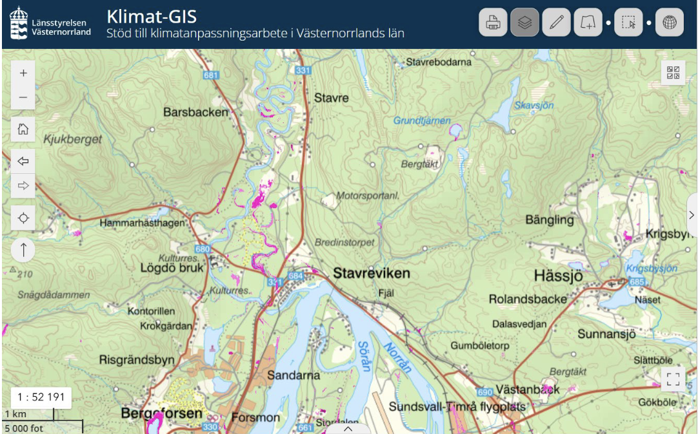
    <figcaption>Figure 5. Example of a cloudburst mapping (skyfallskartering) layer showing estimated water depths (m) in mapped low-point areas (lågpunkter). The map identifies enclosed low-lying areas where water may accumulate during extreme rainfall events and provides an indication of potential inundation depths.(Source: Länsstyrelsen Västernorrland; UVCRA-CLIMAAX; Deliverable 2)</figcaption>

## 4. Detailed exposure mapping and risk prioritisation

Connecting projected changes in extreme rainfall with locally detailed exposure and vulnerability information helps identify people, infrastructure and essential services that may be affected. This pathway extends HRW assessments by incorporating spatial information on population distribution, mobility, buildings, critical facilities and service networks to better represent local risk conditions.

The regional applications illustrate how more detailed exposure information can support the identification of vulnerable receptors, potential service disruptions and priority areas for risk management and adaptation.

### Region Examples

#### Hegyvidék District (Hungary)

Hegyvidék District incorporated high-resolution population mobility and essential-service information to refine its urban risk assessment. Aggregated telecommunications and GPS mobility data at 50 × 50 m resolution were combined with information on public transport, schools, healthcare, social-care facilities and other essential services.

These datasets were integrated with rainfall hazard and vulnerability indicators to develop urban-block risk maps for different time periods and climate scenarios. By accounting for variations in population presence and mobility, the approach provides a more detailed representation of who may be exposed, where and when, alongside the essential services potentially affected.

  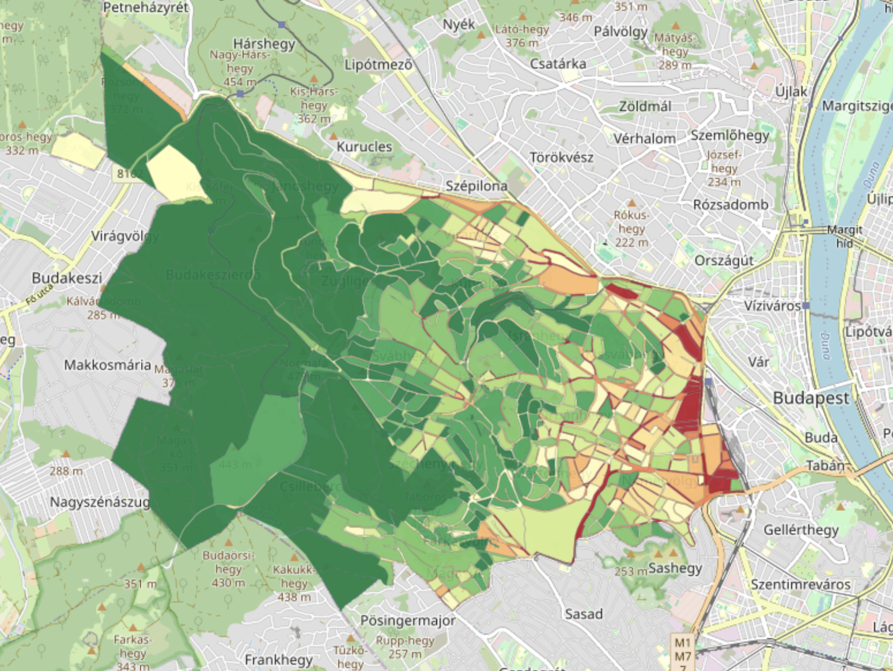
    <figcaption>Figure 6. Heavy Rainfall Risk maps of Hegyvidék Municipality for the RCP4.5 scenario for the period 2041-2070. Red indicates high risk, green indicates low risk. (Source: Hegyvidék District; MARCAdapt; Deliverable 2)</figcaption>

#### St. Wendel District (Germany)

St. Wendel combined local heavy-rainfall hazard maps with detailed spatial information on critical and social infrastructure, including care facilities, public administration, food supply and energy infrastructure.

The results help identify potentially vulnerable locations and support civil protection, emergency preparedness and municipal planning. The assessment also considers the district’s local context, including the 2024 Pentecost flood, when St. Wendel recorded 107 mm of rainfall in 24 hours, close to its current 100-year rainfall threshold.

  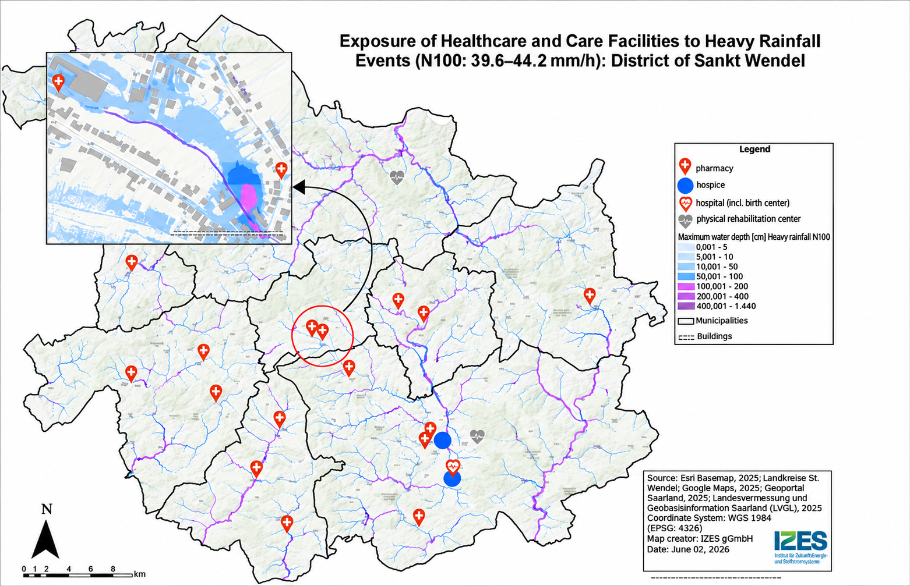
    <figcaption>Figure 7. Heavy rainfall and care facilities (© IZES gGmbH) based on ESRI base map and (LVGL 2026). (Source: St. Wendel District; CliRAs - WND; Deliverable 2)</figcaption>

#### Southwest Finland (Finland)

In Southwest Finland, the heavy rainfall assessment was linked to the location of key infrastructure and the region’s most populated municipalities. Hospitals and fire stations were mapped alongside projected changes in rainfall magnitude to identify areas where critical services could face increasing pressure. The analysis highlighted, for example, the area around Salo, where high projected precipitation increases coincide with a history of flooding.

This approach helps identify where changes in heavy rainfall may have greater consequences for population and essential services, supporting the prioritisation of adaptation measures. 

  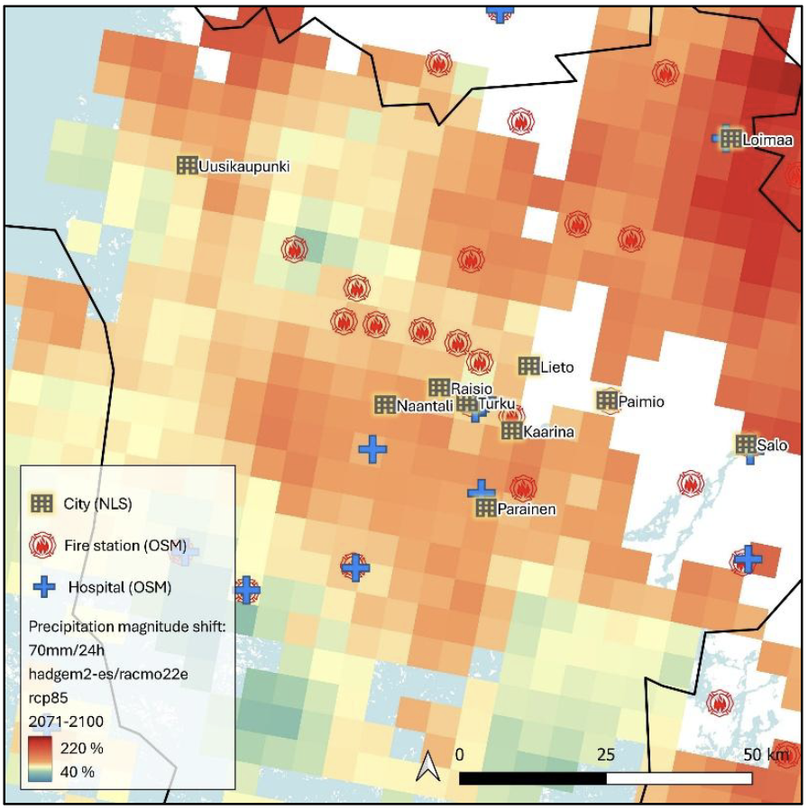
    <figcaption>Figure 8. Key infrastructure and the ten most populated
municipalities in Southwest Finland. Basemap: NLS. (Source: Southwest Finland; CLIVAS; Deliverable 2)</figcaption>

#### Tipperary County (Ireland)

Tipperary extended its HRW assessment by combining projected rainfall conditions with high-resolution terrain analysis to map potential surface-water flooding across six settlements. The Phase 1 rainfall estimates were combined with LiDAR-derived Digital Elevation Models (DEMs), using terrain-analysis tools to identify flow directions, flow accumulation pathways and local depressions. The analysis covered six settlements: Cahir, Carrick-on-Suir, Cashel, Clonmel, Thurles and Tipperary.

The assessment compared a present-day 1-in-100-year rainfall event of 67 mm with a future event of 74 mm under RCP8.5 for mid-century. The model allowed rainfall to flow downhill and accumulate in low-lying areas, producing indicative maps of potential flood extent and relative depth. These outputs were then intersected with road and building data to identify exposed assets and estimate impacts using WhiteBoxTools.

  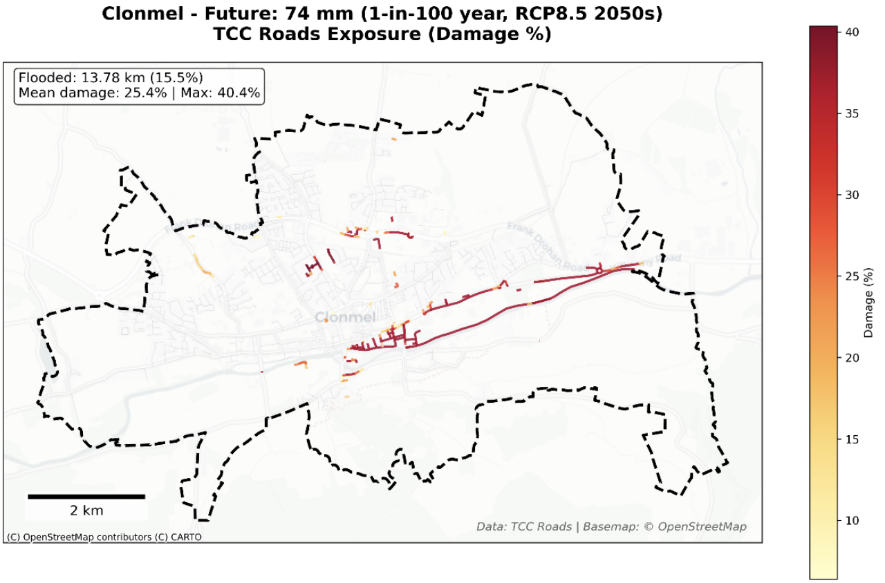
    <figcaption>Figure 9. Surface water flooding damage assessment for roads in Clonmel under 1‑in‑100‑year event in RCP8.5 by mid-century, showing the spatial distribution of inundated road segments and the estimated percentage damage derived fromflood depths and JRC depth–damage functions. (Source: Tipperary County; CLIMAAX Tipperary; Deliverable 2)</figcaption>

## 5. From extreme rainfall to secondary hazards

Extreme rainfall can trigger secondary hazards such as flash floods, river flooding and landslides, depending on local terrain, soil properties and catchment conditions. This pathway extends the HRW by connecting projected changes in extreme precipitation with the physical processes and environmental conditions that influence these hazards.

Regional applications illustrate different approaches to this connection, including catchment-scale rainfall analysis, flood-susceptibility assessment and rainfall-induced landslide assessment. These approaches help translate climate projections into information relevant to local hazard assessment and risk management.

### Region Examples

#### La Réunion (France)

La Réunion developed a catchment-based rainfall assessment to support the analysis of torrential flooding across the island's mountainous terrain. The approach combined hourly precipitation from the high-resolution AROME-SWIO climate simulation (approximately 3 km) with a 25 m Digital Elevation Model (DEM).

Terrain analysis was used to derive flow directions, flow accumulation patterns and catchment boundaries. Rainfall was then aggregated over individual catchments and analysed across different durations using intensity–duration–frequency (IDF) methods, providing catchment-specific information on extreme precipitation relevant to flash-flood assessment.

  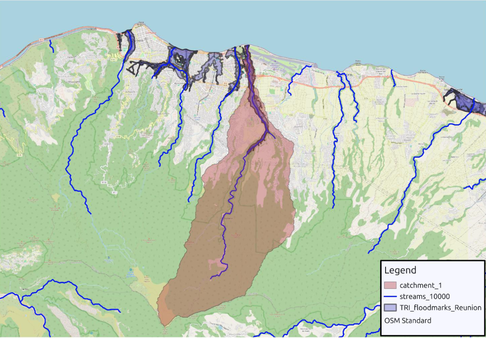
    <figcaption>Figure 10. Example of catchment delineation (Riviere des Pluies) on eastern part of the Saint-Denis TRI. (Source: La Réunion; RISC RA; Deliverable 2)</figcaption>

#### Hopa (Türkiye)

Hopa is located in a mountainous area of northeastern Türkiye, where heavy rainfall has frequently triggered landslides. The assessment used records of past landslides to develop susceptibility maps based on terrain and environmental conditions. The analysis showed a strong link with extreme rainfall, as 221 of the 227 recorded landslide polygons were associated with the event of 24 August 2015, when 287.2 mm of rain fell in 24 hours.

The susceptibility maps were then considered alongside future extreme precipitation projections to assess how more frequent and intense rainfall could increase landslide risk. The results identified around 360 buildings and 16 km of roads in areas of high or very high susceptibility, highlighting the potential consequences for infrastructure and accessibility. This approach shows how landslide susceptibility assessment can be combined with future rainfall projections to identify areas where climate change may increase rainfall-induced landslide risk.

  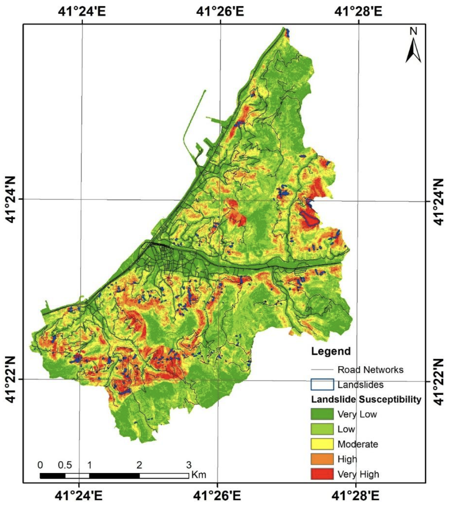
    <figcaption>Figure 11. Landslide susceptibility map of the study area. (Source: Hopa; SAFE-HOPA; Deliverable 2)</figcaption>

## Authors
The Center of Applied Research in Hydrometrology from the Universitat Politècnica de Catalunya (CRAHI-UPC). \
The members involved in the development of this workflow were the following:

Erika R. Meléndez-Landaverde \
Víctor González Garrido \
Daniel Sempere-Torres \
Pol Perez De Gregorio Bermudez

## References 

County Council of Louth, Grant Thornton Ireland, & M-CO. (2026). *Deliverable Phase 2 – Climate risk assessment: Applying the CLIMAAX framework to County Louth, Ireland*. https://gebrada.upc.es/climaax-deliverables/deliverables/b90e5a95-84dd-4190-8b24-bfdcbdd0cb4f/

Décsi, E., Laki, N., Bogdány, V., Janosov, M., Fejes, L., Teveli-Horváth, D., & Szőllőssy, A. (2026). *Phase 2 – Climate risk assessment* [MARCAdapt deliverable]. Municipality of the 12th District of Budapest (Hegyvidék Municipality). https://gebrada.upc.es/climaax-deliverables/deliverables/d4785280-06fe-4c8f-b31b-90ab238d5f8c/

Dolci, R., Chiaravalli, M., Cribellati, M., Garolini, A., Pregnolato, M., & Battezzati, L. (2026). *Deliverable Phase 2 – Climate risk assessment: Context specific climate risk assessment and adaptation strategies for the Valchiavenna Alpine territory (CMV4Clima)* [Report]. Comunità Montana della Valchiavenna. https://gebrada.upc.es/climaax-deliverables/deliverables/10178aaa-c505-4c8a-abcb-f707a2a20430/

Henriques, R., Almendra, R., Sousa, L., Caldas, A. R., Martins, I., Vieira, J. P., Matos, E., & Cruz, A. (2026). *Phase 2 – Climate risk assessment* [Viana do Castelo: Climate Action deliverable]. Viana do Castelo Municipality. https://gebrada.upc.es/climaax-deliverables/deliverables/81c0ec79-aebd-40a2-b602-ac4300d98ec4/

Kadan, N., Akıncı, H., Beyazlı, D., Özlü, S., & Dedeoğlu Özkan, S. (2026). *Phase 2 – Climate risk assessment* [SAFE-HOPA deliverable]. Hopa Municipality. https://gebrada.upc.es/climaax-deliverables/deliverables/cf4ecb2d-3eaa-419a-acbc-543885b4cd6e/

Kivimäki, S., Lappalainen, O., Badawieh, O., Haapanen, O., & Leksis, I. (2026). *Phase 2 – Climate risk assessment* [CLIVAS deliverable]. Regional Council of Southwest Finland / Valonia. https://gebrada.upc.es/climaax-deliverables/deliverables/3a59a66e-2792-45b5-ad18-eb1f88c7ce0b/

Lee, C., & KPMG Ireland. (2026). *Phase 2 – Climate risk assessment* [CLIMAAX Tipperary deliverable]. Tipperary County Council. https://gebrada.upc.es/climaax-deliverables/deliverables/4438ca01-b585-413c-9795-881124f4b81e/

Marpinard, E., Lamy, K., & Poncet, N. (2026). *Phase 2 – Climate risk assessment* [RISC-RA deliverable]. Région Réunion. https://gebrada.upc.es/climaax-deliverables/deliverables/d549de1d-8fc1-483f-ab1f-a662a220e252/

Mersin Metropolitan Municipality, Climate Change and Zero Waste Department. (2026). *Phase 2 – Climate risk assessment* [MCR-RA deliverable]. Mersin Metropolitan Municipality. https://gebrada.upc.es/climaax-deliverables/deliverables/874a9fab-d4a6-4222-b68e-ee93c8bbc233/

The County Administrative Board of Västernorrland. (2026). *Phase 2 – Climate risk assessment: Updating Västernorrland’s climate risk and vulnerability assessment using the CLIMAAX methodology*. https://gebrada.upc.es/climaax-deliverables/deliverables/5808840a-af3e-4c2b-bc01-0e486af948a8/

Valdearcos Teruel, D., Navarro Molina, A., & Núñez Iranzo, L. (2026). *Phase 2 – Climate risk assessment* [QCATI deliverable]. City Council of Quart de Poblet. https://gebrada.upc.es/climaax-deliverables/deliverables/6c564168-fa1e-4bd1-a9af-bdd4cfc70590/

Schäfer, D., Jung, D., Spath, S., Seegmüller, L., Siemer, D., & Meiser, L. (2026). *Phase 2 – Climate risk assessment: Results of Phase 2 of CliRAs-WND*. District Sankt Wendel and IZES gGmbH. https://gebrada.upc.es/climaax-deliverables/deliverables/aef24a0b-9863-46dc-9c93-5f0813e08eaa/